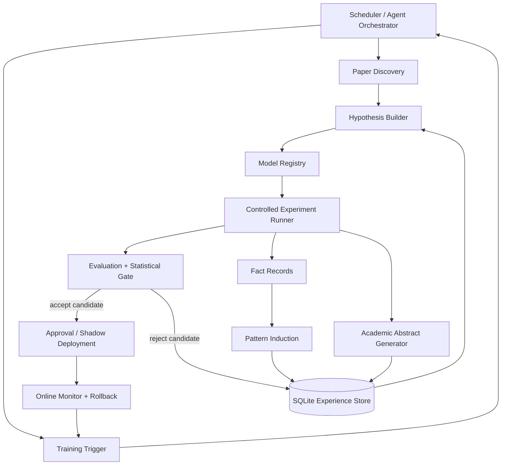
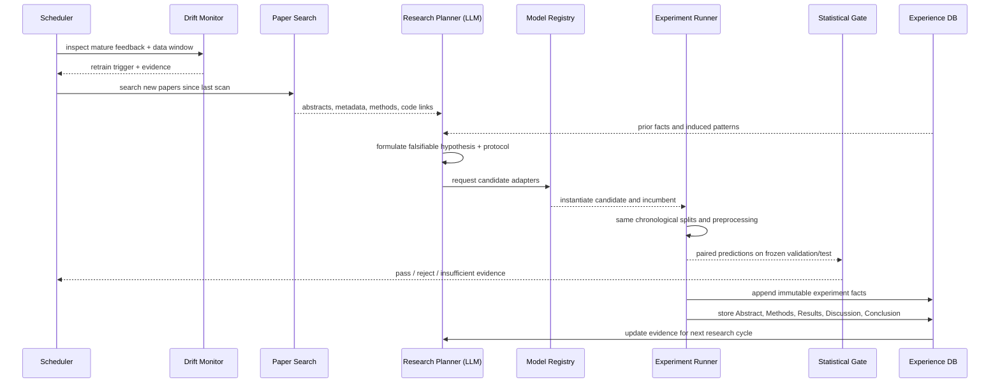

# ATREA architecture and autonomous cycle

## Full autonomous cycle

## Required controls
- Separate train/validation/test chronologically. Tune only on validation; use the final test once per model-selection protocol.
- For multi-equipment transfer, add leave-one-equipment-out evaluation; ETTh1/ETTh2 are not independent industrial equipment fleets.
- Store split hash, raw data hash, preprocessing version, random seed, source commit and dependency lock.
- Bootstrap paired errors by forecast origin (not by individual overlapping horizon points) to avoid overstating effective sample size. Use block bootstrap where temporal dependence remains.
- Statistical significance is necessary but not sufficient: enforce absolute error limits, tail-risk limits and critical operating-condition/fault strata.
- Candidate code and weights run in an isolated environment. Paper-derived code is untrusted; never execute arbitrary install scripts or repository code automatically.
- Promotion requires an explicit policy gate, shadow evaluation, monitoring and rollback. Research agents may propose; they must not silently deploy.
